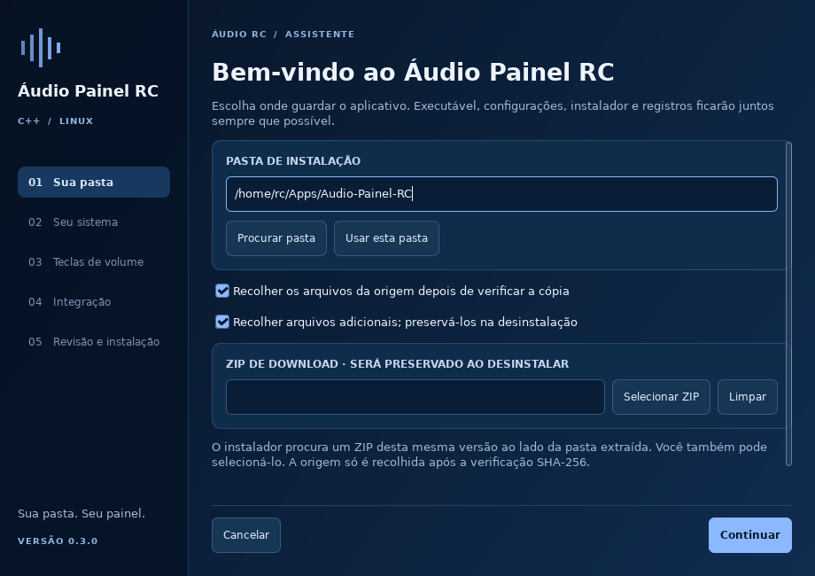

# Áudio Painel RC · C++ 0.3.0

Painel de áudio para Linux com **instalador gráfico azul-escuro**, organização
portátil e central independente. Usa o áudio PipeWire/WirePlumber já existente.
Inclui código-fonte e executáveis Linux x86-64; não exige compilação para o
ambiente declarado abaixo. Não usa Python, Electron, navegador ou Qt em execução.


## Organização do código e GitHub

O código agora está dividido em módulos (`src/interface`, `src/audio`,
`src/sistema`, `src/instalador`, `src/aplicacao`, `src/ferramentas`, `src/testes`).
Para mudar só as cores/estilo, comece por **`src/interface/tema.cpp`**.
O instalador continua sendo distribuído com binários na pasta principal.

- [Mapa da arquitetura](docs/ARQUITETURA.md)
- [Tutorial do GitHub, em português](docs/GUIA-GITHUB.md)
- [Regras de contribuição](docs/CONTRIBUINDO.md)
- [Próximas melhorias](docs/PLANO-DE-MELHORIAS.md)

O ZIP de **fontes** não contém executáveis; execute `bash compilar.sh` para
produzi-los e gerar `ARQUIVOS.txt` / `SHA256SUMS.txt` antes de instalar.
O ZIP de **instalador** já vem compilado e inclui esses arquivos.


## Instalar

1. Extraia o ZIP inteiro, obtendo `Audio-Painel-RC-CPP/`.
2. Abra **Iniciar**, o pequeno lançador executável da pasta.
3. Escolha a pasta, ou **Usar esta pasta** para manter a extração portátil.
4. Confira o sistema, teste as teclas se desejar e escolha os atalhos opcionais.
5. Confira o resumo e clique **Instalar**.

Nas próximas aberturas, **Iniciar** abre o painel sem repetir a instalação.
Para abrir o instalador novamente: `Instalar.sh`. Para configurar apenas teclas:
`Teclado.sh` ou **Configurações → Teclado e Fn**.

Alguns gerenciadores de arquivos não preservam a permissão de execução ao
extrair ZIPs, ou pedem confirmação de confiança. Nesse caso, marque **Permitir
executar** nas propriedades de `Iniciar` e `audio-painel-rc`, ou abra o terminal
da pasta e execute:

```bash
bash iniciar.sh
```

O pacote é para **Linux**, não é um `.exe` de Windows. Não usa `sudo`, não
instala pacotes, não troca o servidor de áudio e não substitui o KMix ao iniciar.

## Tudo na pasta

Executável, lançador, instalador, desinstalador, código, ícones, preferências,
registros, backups próprios e temporários de instalação ficam no destino.

O assistente tenta reconhecer o ZIP da mesma versão ao lado da pasta extraída.
Você também pode selecioná-lo. Após copiar e conferir os arquivos com SHA-256,
o ZIP vai para `instalador/` e a origem é recolhida, se a opção estiver marcada.
Arquivos adicionais recolhidos ficam em `instalador/arquivos-preservados/` e
continuam preservados na remoção. Registros anteriores ficam em
`instalador/registros-origem/`. Links adicionais não são seguidos; qualquer
resto conhecido na origem aparece no relatório com seu caminho e motivo.

**Arquivos externos são opcionais e aparecem antes de instalar.** As opções
de autostart, menu e área de trabalho começam desmarcadas. Leia
[ARQUIVOS-FORA.md](docs/ARQUIVOS-FORA.md). `RELATORIO-INSTALACAO.txt`,
`instalacao.json` e `integracoes.json` registram o resultado dentro do app.

Feche o painel e a central antes de atualizar ou mover a instalação.
O instalador reconhece um destino do Áudio RC e preserva as preferências dele.
Se mover a pasta manualmente, execute **Iniciar**, escolha **Usar esta pasta**
e confira a reparação dos atalhos. Atalhos editados ou pertencentes a outra
instalação são preservados para revisão.

## Recursos de áudio preservados

- Layouts 1, 3 e 4; escuro padrão, claro e tema do sistema.
- Master e microfone com volume e mudo separados; HDMI, P2 e portas reais.
- Mixer de aplicativos com volume, mudo, saída individual e acompanhar padrão.
- Integração com filtro RNNoise já configurado, sem desativá-lo ao trocar porta.
- Central independente, ganho físico e identificação de mudo antes do filtro.
- Teste da própria voz com **buffer de 1 segundo**, medidor e botão Parar.
  O teste não salva gravações e para ao sair da página, minimizar ou após 30 s.
- Personalização de cor, largura, opacidade do fundo, texto, densidade, cantos,
  distância da barra, área do mouse e espera para esconder.

Detalhes: [MANUAL-AUDIO.md](docs/MANUAL-AUDIO.md). A automação HDMI e o filtro já
existentes não são movidos, desativados ou apagados.

## Teclas de volume / Fn

O padrão é **modo compatibilidade**: o desktop controla suas teclas e o painel
acompanha os eventos de áudio. Nenhuma reserva global é criada nesse modo.

No X11, o assistente permite testar silenciar, diminuir e aumentar, ou escolher
combinações com Ctrl, Alt ou Super. Verde significa **evento recebido no teste**;
encontrar um código no mapeamento não é confirmação física. Uma tecla capturada
nesta janela não significa, por si só, que ela já foi registrada globalmente.
**Verificar disponibilidade** tenta a reserva real e verifica erros do X11.

O controle direto é opcional, usa somente funções confirmadas e livres e
funciona no processo da bandeja. O passo pode variar de 1% a 15%. Ao encontrar
conflito, o app libera suas reservas e mantém o desktop responsável. Não tenta
adivinhar qual processo reservou a combinação, nem monitora toda a digitação.

Após reconfigurar pelo assistente, reabra a central para atualizar o resumo das teclas.

O botão **Atalhos do desktop** abre a ferramenta do ambiente quando reconhecida.
Esta versão **não altera automaticamente os atalhos do desktop**, não gera
comandos genéricos para liberá-los e não promete transferir uma tecla ocupada.
Se você modificar atalhos manualmente, a restauração é feita pela ferramenta
do desktop. As reservas temporárias do Áudio RC são liberadas ao desativar o
controle direto ou encerrar o processo; não deixam arquivo de teclado externo.

## Compatibilidade declarada

| Recurso | Situação nesta versão |
|---|---|
| Linux x86-64, glibc e bibliotecas abaixo | Binários incluídos |
| Q4OS / Debian 13 com Trinity e PipeWire | Ambiente principal solicitado; validação final no notebook pendente |
| Outros desktops X11 | Detecção, autostart XDG e atalhos X11 implementados; testes de desktop reais pendentes |
| Desktop sem bandeja GTK3/XEmbed | O painel abre como janela normal, sem esconder ao sair com o mouse |
| Wayland | Modo compatibilidade; posicionamento global/auto-ocultar limitados; registro GlobalShortcuts ainda não implementado |
| PulseAudio independente | Detectado, mas backend de controle ainda não implementado |
| ARM, 32 bits e glibc antiga | Não há executável pronto neste ZIP; não anunciar suporte testado |
| Substituição do KMix | Somente no Trinity, por ação explícita separada; não é etapa do instalador |

Requisitos de execução: GTK3 (`libgtk-3.so.0`), GLib/GObject/Cairo, libstdc++,
glibc **2.38 ou superior**, símbolos **GLIBCXX_3.4.29 / CXXABI_1.3.13**, sessão
gráfica, PipeWire/WirePlumber e suas ferramentas `wpctl`, `pw-dump`,
`pw-metadata` e `pw-cat` (este último para o teste de voz). Atalhos diretos no
X11 usam `libX11.so.6`, carregada quando necessário. O instalador explica
ausências detectáveis; não baixa nem instala dependências silenciosamente.

Não há promessa de funcionamento universal. Veja [VALIDACAO.md](docs/VALIDACAO.md).

## Desinstalar

Abra **Desinstalar.sh**, ou **Configurações → Sobre / Instalação → Desinstalar**.
Na sessão gráfica aparece o desinstalador azul-escuro. No terminal sem sessão
gráfica, ele pede `REMOVER`. A opção explícita `--sim` permite remoção pelo CLI.

O desinstalador encerra somente instâncias desta pasta, consulta os registros,
confere atalhos externos e remove arquivos próprios. Se um atalho foi editado,
interrompe a remoção e mantém o aplicativo e o registro para revisão. A troca
opcional do KMix tem registro próprio e restauração da chave relevante.
**ZIPs, arquivos pessoais e estado compartilhado são preservados.** Por isso
a pasta pode continuar existindo com esses itens. Apagar a pasta manualmente
não executa a restauração dos atalhos: use o desinstalador primeiro.

## Testes e RAM

```bash
bash testar.sh
bash testar-instalacao.sh
bash testar-integracao.sh
bash Diagnostico.sh
bash medir-ram.sh --cenario "bandeja" --espera 5
bash medir-ram.sh --cenario "painel aberto" --espera 8
```

Os testes de instalação usam uma pasta privada dentro de `testes/` e um HOME
fictício, sem configurar seu desktop. Os testes de I/O compilam um simulador
local e exigem G++; os demais já fazem parte do executável. `Diagnostico.sh`
é somente leitura e nunca executa `wpctl --version`.

O relatório do usuário informa **17,30 MiB PSS** para a versão C++ anterior
completa, incluindo **1,60 MiB** do `pw-dump`. A versão atual ainda precisa ser
medida no mesmo notebook e cenário. O medidor inclui bandeja, central e seus
auxiliares, sem esconder processos do teste de voz. O instalador termina ao
concluir; não fica um serviço adicional. O teclado direto usa o processo
principal; compatibilidade não inicia um monitor global de teclado.

## Compilar e publicar

```bash
bash compilar.sh
# ou:
CXX=/caminho/para/g++ bash compilar.sh
```

O script procura o G++ portátil em `$HOME/Apps/G++`, incluindo a estrutura
`dependencias/rootfs/usr/bin/g++-14`, e depois o compilador do sistema. Também
aceita `RC_GXX_ROOT`. Não exige headers GTK/X11 de desenvolvimento nem instala
pacotes. Temporários ficam dentro da pasta do projeto. O compilador, binutils,
headers C/C++ e bibliotecas de sistema usuais são necessários para recompilar.

Código completo em `src/` e lançador em `ferramentas/launcher.c`. Licença [MIT](LICENSE).
Histórico em [CHANGELOG.md](CHANGELOG.md). O ZIP está preparado para anexar a
uma release do GitHub; nenhum repositório foi publicado automaticamente.

Referências de implementação: [GTK3](https://docs.gtk.org/gtk3/),
[Xlib](https://www.x.org/releases/X11R7.6/doc/libX11/specs/libX11/libX11.html),
[XDG Autostart](https://specifications.freedesktop.org/autostart-spec/latest/),
[GlobalShortcuts](https://flatpak.github.io/xdg-desktop-portal/docs/doc-org.freedesktop.portal.GlobalShortcuts.html)
(investigado; registro Wayland ainda pendente).
